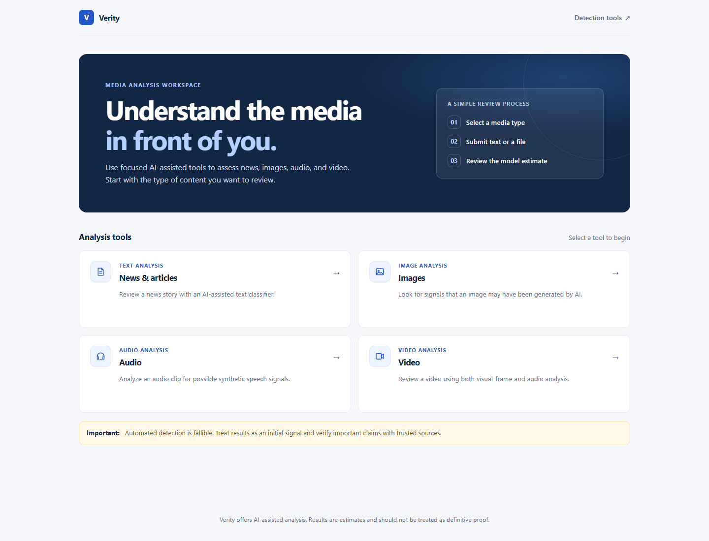
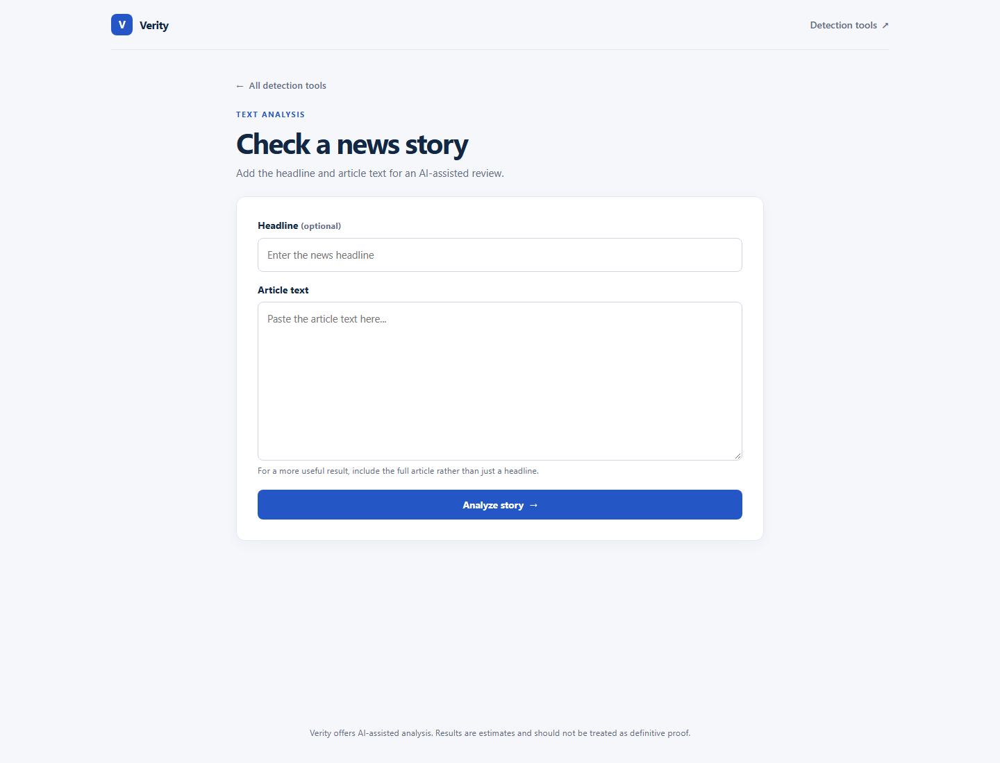
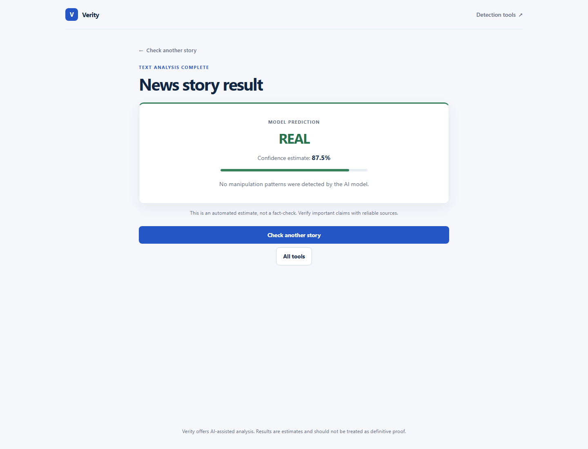
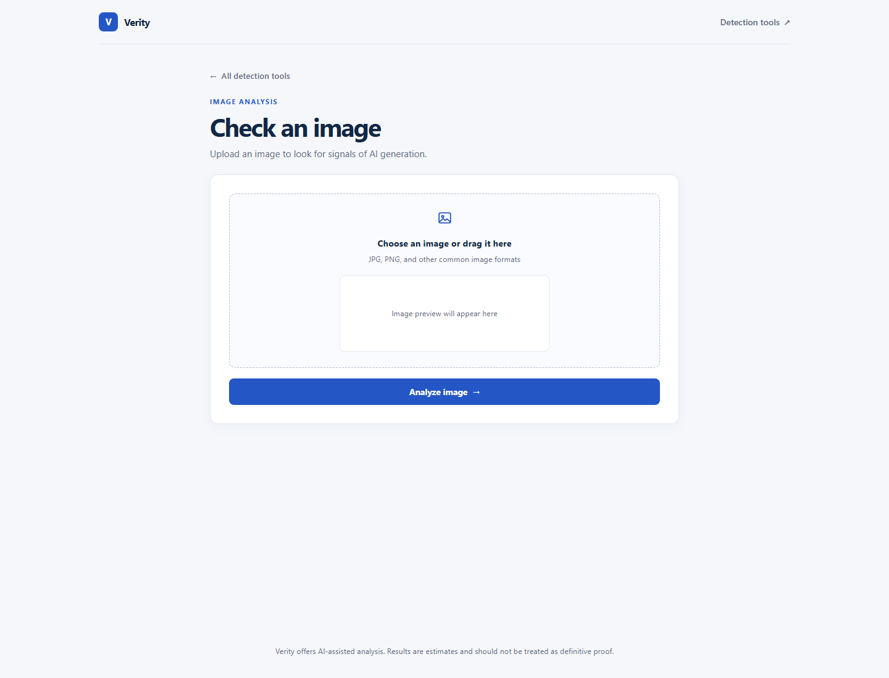

# Verity

Verity is a Flask application for AI-assisted analysis of news text, images, audio, and video. Results are estimates, not definitive proof; verify important claims with trusted sources.

## Screenshots

### Dashboard



### News analysis

<table>
  <tr>
    <td align="center"><strong>Submit a story</strong></td>
    <td align="center"><strong>Analysis result</strong></td>
  </tr>
  <tr>
    <td></td>
    <td></td>
  </tr>
</table>

### Image analysis



## Features

- Analyze news headlines and article text.
- Check images for possible AI-generation signals.
- Analyze audio for possible synthetic speech.
- Review video using visual-frame and audio analysis.

## Run locally

Use Python 3.11. From the project directory, create and activate a virtual environment, then install the dependencies:

```powershell
py -3.11 -m venv .venv
.\.venv\Scripts\Activate.ps1
python -m pip install --upgrade pip
pip install -r requirements.txt
python app.py
```

Open [http://127.0.0.1:5000](http://127.0.0.1:5000). The first launch may take a while because the image and audio models are downloaded on startup; an internet connection is required.

## Deploy on Render

The repository includes a Render Blueprint in `render.yaml`. To create a free demo deployment:

1. Push or merge this configuration to the repository's `main` branch.
2. In the [Render Dashboard](https://dashboard.render.com/), select **New → Blueprint** and connect this repository.
3. Review the `verity` web service and click **Apply**. Render generates the Flask secret and provides a public `onrender.com` URL when deployment succeeds.

The free plan is for demos and may not have enough memory or disk space for PyTorch and the downloaded image/audio models. Free services can also sleep when idle, their local files and model cache are temporary, and first boot can be slow. If the build or startup fails from resource limits, use a paid instance with more memory.
